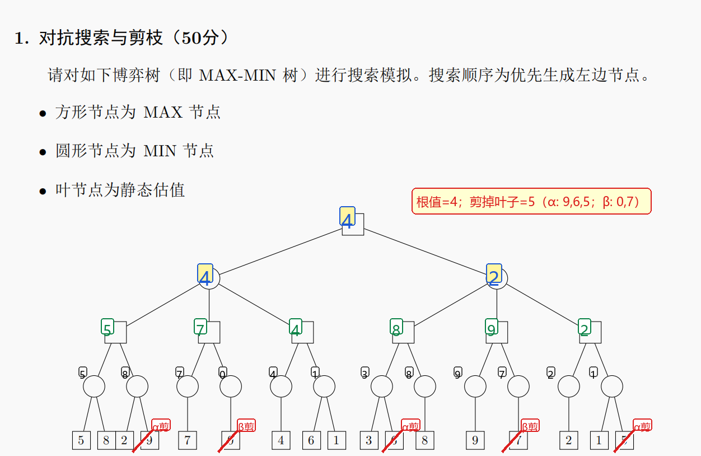

# ==人工智能原理 Final Cheatsheet==

## ==搜索 Search==
**问题形式化**：状态 $S$；初始 $s_0$；动作 $A(s)$；转移 $Result(s,a)$；目标 $Goal(s)$；代价 $c(s,a,s')$。解=动作序列。评价：完备、最优、时间、空间。$b$ 分支，$d$ 最浅解，$m$ 最大深度，$C^*$ 最优代价。树搜索不去重；图搜索用 explored/reached 去重，防环但费内存。形式化题：变量化状态、写初态/目标、动作合法条件、边界/障碍、代价。

**BFS/UCS/DFS**：BFS FIFO，完备，等代价最优，时空 $O(b^d)$；UCS 按 $g$ 小扩展，单步代价 $>0$ 完备且最优，所有边等代价时退化 BFS；DFS LIFO，有限且防环完备，不最优，空间 $O(bm)$。图搜索生成子结点时：若已扩展/已在边界且无更优路径则丢弃。

**Best-first / A\***：通用 best-first 用评价函数 $f$ 排 OPEN。贪心 $f=h$，只看估计，快但不保最优。A*：$f(n)=g(n)+h(n)$。$g$ 已走真实代价；$h$ 估计剩余代价；$h^*$ 真实剩余最短代价。目标位置未知：先 BFS/DFS/在线搜索探索建图，记录可通行格、毒气格、墙/塌方边；对最近未探索边界跑 A*，发现目标位置后再以其为目标重跑 A*，即在线搜索/实时重规划。可采纳：$0\le h(n)\le h^*(n)$，不高估；$h=0$ 可采纳但退化 UCS。一致：$h(n)\le c(n,n')+h(n')$，图搜索最优；一致 $\Rightarrow$ 可采纳。支配：若 $h_2\ge h_1$ 且都可采纳，$h_2$ 通常扩展更少。构造：松弛问题最优解；八数码曼哈顿距离支配错位数。

**A\* / UCS 例题**：每步写“扩展结点 $n$”；对子结点算 $g(n')=g(n)+c$、$h(n')$、$f=g+h$；OPEN 按 $f$ 升序列全，平局按题目字母序；图搜索若新 $g$ 更小则更新父指针和 $f$；目标结点出队时返回路径。例：$S\to A=1,h(A)=3$，$S\to B=4,h(B)=1$，则 $f(A)=4,f(B)=5$，先扩 $A$；若之后得到 $G:g=4,f=4$，目标出队返回；若另一路 $B\to G$ 代价 $5$，不更新 $G$。

**复杂环境**：完全可观测+确定动作 $\to$ 普通搜索；完全可观测+不确定动作 $\to$ AND-OR/条件计划；部分/无观测+确定动作 $\to$ 信念状态搜索；部分/无观测+不确定动作 $\to$ 信念状态+AND-OR。信念状态 $b$ = 可能真实状态集合。无观测只按动作更新；部分可观测先预测再用观测过滤。AND 结点=环境所有结果都要可解；OR 结点=智能体选一支可解即可。解是条件计划。

**Minimax**：二人零和，MAX 我方，MIN 对手。$V(s)=Utility(s)$ if terminal；MAX 取 $\max_aV(Result(s,a))$；MIN 取 $\min_aV(Result(s,a))$。深度截断用 $Eval(s)$，常写 $Eval(s)=\sum_iw_if_i(s)$，要求相关、快速、能区分局面。地平线效应：截断深度外的坏事看不到；可拓展不稳定结点。

**α-β 剪枝**：$\alpha$=MAX 当前已知下界，$\beta$=MIN 当前已知上界。MIN 结点若当前值 $\le\alpha$，MAX 不会选，剪；MAX 结点若当前值 $\ge\beta$，MIN 不会让到，剪。不改变根值，只省结点；排序好时近似 $O(b^{m/2})$。

**α-β 例题（左优先）**：

方形=MAX，圆形=MIN。图中左半树三棵 MAX 子树值为 $5,7,4$，左 MIN 值 $4$；右半树三棵 MAX 子树值为 $8,9,2$，右 MIN 值 $2$；根 MAX 值 $\max(4,2)=4$。αβ 按左到右可剪叶：$9,6,5$ 为 α 剪，$0,7$ 为 β 剪，共 $5$ 个叶子。Minimax 访问全部叶子；αβ 少访问结点但不改根值，因为被剪分支已不可能改变祖先的 $\max/\min$ 选择。

**MCTS**：Selection $\to$ Expansion $\to$ Rollout $\to$ Backpropagation。子结点存胜数/访问数 $w_i/n_i$，父结点访问数 $N$。$UCB_i=w_i/n_i+c\sqrt{\ln N/n_i}$。若统计黑胜率，黑方用 $w_i/n_i$；白方希望黑胜低，用 $1-w_i/n_i$：$U_{\text{white}}=1-w_i/n_i+c\sqrt{\ln N/n_i}$。$c$ 大偏探索，小偏利用；平局按题目。真正落子常选访问数最多或胜率最高（看题目说明）。

**CSP 定义**：$(X,D,C)$，约束 $\langle scope,rel\rangle$。赋值：partial/complete；consistent 不违反约束；solution=complete+consistent。例：$X_1>X_2,D=\{1,2,3\}$ 可列 $\{(3,2),(3,1),(2,1)\}$。全局约束：AllDiff；Atmost。建模例：数独变量=格子，域 $\{1,2,3,4\}$，行列宫 AllDiff；排期中“不能相邻”写 $|A-B|>1$，“先于”写 $D<A$，条件约束写 $B\in\{3,4\}\Rightarrow C\in\{1,2\}$。

**AC-3 / 回溯**：弧相容：$\forall x\in D_i,\exists y\in D_j:C_{ij}(x,y)=true$。AC-3：所有弧入队；取 $(X_i,X_j)$ 做 `REVISE`，删 $D_i$ 中无 $D_j$ 支持的值；若 $D_i$ 变小，则邻弧 $(X_k,X_i)$ 入队；域空无解；约 $O(cd^3)$。回溯四步：选变量 MRV（合法值最少，fail-first）/度启发式；选值 LCV（删邻居值最少，fail-last）；推理 FC/MAC/AC-3；失败回溯。局部搜索 Min-conflicts 适合大规模。

**搜索/CSP 易错**：BFS 最优只在等代价；BFS 按层搜索，生成目标即可停，画生成树通常画第一次发现的父子关系；UCS/A* 追求代价最优，目标入队不能停，必须出队/扩展才停；DFS/贪心遇目标可停但不保最优。一致性检查每条边；AC-3 只传播，不一定求完整解；MRV 选变量，LCV 选值。

## ==神经网络 NN==
**监督学习/模型选择**：给 $\{(x_i,y_i)\}$ 学 $h_w(x)$。训练集训练参数，验证/dev 调超参与选模型，测试集只做最终评估；数据少用 $k$ 折。目标 $J(w)=\frac1n\sum_i\ell(h_w(x_i),y_i)+\lambda\Omega(w)$。L2：$\lambda\sum_iw_i^2$，梯度多 $2\lambda w$；L1：$\lambda\sum_i|w_i|$，促稀疏。过拟合：训练误差低、验证/测试误差高；欠拟合：训练误差也高。泛化误差 = 偏差$^2$ + 方差 + 噪声。

**线性回归**：$h_w(x)=w^\top x+w_0$。流程：训练集拟合 $w,b$，测试集算 $\hat y$ 和指标；调参/选模型另划验证集，测试集只最终评估。$L(w)=\sum_j(y_j-h_w(x_j))^2=\|Xw-y\|^2$；$\nabla_wL=2X^\top(Xw-y)$；$w\leftarrow w-\alpha\nabla L$。若加 L2，梯度再加 $2\lambda w$。一步 SGD 常先算误差 $e=y-\hat y$，再近似 $w\leftarrow w+\alpha e x,b\leftarrow b+\alpha e$。正规方程 $w^*=(X^\top X)^{-1}X^\top y$，矩阵奇异用伪逆。一元：$w_1=\frac{\sum(x_i-\bar x)(y_i-\bar y)}{\sum(x_i-\bar x)^2},w_0=\bar y-w_1\bar x$。指标：$\mathrm{MSE}=\frac1m\sum_i(\hat y_i-y_i)^2$，$\mathrm{MAE}=\frac1m\sum_i|\hat y_i-y_i|$，$R^2=1-\frac{\sum(y-\hat y)^2}{\sum(y-\bar y)^2}$。

**Logistic / 感知机**：$\sigma(z)=1/(1+e^{-z})$，$\sigma'(z)=\sigma(z)(1-\sigma(z))$，$h=\sigma(w^\top x+b)$，边界 $w^\top x+b=0$。课件平方损失更新：$w_i\leftarrow w_i+\alpha(y-h)h(1-h)x_i$，$b\leftarrow b+\alpha(y-h)h(1-h)$。BCE 对 $w_i$ 的梯度常化简为 $(\hat y-y)x_i$，梯度下降更新要减它，别和平方损失更新混。感知机：$w\leftarrow w+\eta(y-\hat y)x$；线性可分收敛，不可分固定学习率可能不收敛。例：$x=2,w=0.5,b=0,y=1$，$h=0.731$，平方损失更新项 $(1-0.731)0.731(0.269)2\approx0.106$。
**XNOR 两层实现**：单感知机不行。阶跃 $step(z)$：隐层 $h_1=step(x_1+x_2-1.5)$ 算 AND，$h_2=step(-x_1-x_2+0.5)$ 算 NOR；输出 $y=step(h_1+h_2-0.5)$。

**MLP 前向/激活**：$z^{(l)}=W^{(l)}a^{(l-1)}+b^{(l)}$，$a^{(l)}=g(z^{(l)})$。Sigmoid 平滑但两端梯度小；Tanh 零中心但仍消失；ReLU $\max(0,z)$ 快、缓解消失但有死区。万能逼近：单隐层足够宽可逼近连续函数；深层参数效率更高。

**Softmax + CE**：$p_k=e^{z_k}/\sum_je^{z_j}$，$\sum p_k=1$。交叉熵 $L=-\sum_ky_k\log p_k=-\log p_{true}$。化简梯度：$\partial L/\partial z_k=p_k-y_k$。真实类别处 $p_k-1<0$，梯度下降会增大该类 logit；非真实类别 $p_k>0$，下降会减小。手算：先算 $e^z$ 和归一化，再 $p-y$。

**扰动法 / BP**：扰动法 $g_k\approx[L(w_k+\epsilon)-L(w_k)]/\epsilon$，直观但每个参数重算损失，慢。BP：$\delta^{(L)}=\nabla_aL\odot g'(z^{(L)})$；Softmax+CE 时 $\delta=p-y$；$\delta^{(l)}=(W^{(l+1)})^\top\delta^{(l+1)}\odot g'(z^{(l)})$；$\partial L/\partial W^{(l)}=\delta^{(l)}(a^{(l-1)})^\top$，$\partial L/\partial b^{(l)}=\delta^{(l)}$。$\odot$ 逐元素乘。梯度形状必须和参数同形。

**BP 数字题例题**：前向存所有 $z,a$；输出层算 $\delta$；逐层往前乘 $W^\top$ 和激活导数；权重梯度=本层误差 $\times$ 上一层输出转置；偏置梯度=本层误差；最后 $W\leftarrow W-\eta\partial W$。例：logits $z=(2,1,0)$，$p=(0.665,0.245,0.090)$；若真实类别是第一类，$y=(1,0,0)$，$\delta=p-y=(-0.335,0.245,0.090)$；输出层梯度=$\delta h^\top$。若 ReLU 且 $z>0$，$g'=1$；若 $z<0$，$g'=0$。

**CNN 尺寸**：$H_{out}=\lfloor(H_{in}-K+2P_{pad})/S\rfloor+1$，宽同理；$K$ 是核大小，$S$ 是步长，$P_{pad}$ 是 padding 补零圈数；输出通道=卷积核数。same padding 想让 $H_{out}=H_{in}$，当 $S=1$ 且 $K$ 奇数取 $P_{pad}=(K-1)/2$。Pool/池化只改高宽，通道不变。

**CNN 参数量**：Conv 参数 $C_{out}(C_{in}K^2+1)$，$C_{out}$=卷积核数=输出通道；无偏置去 $+1$。Pool/池化层无可学习参数。最后特征图 $H'\times W'\times C'$ 展平接 $M$ 类 FC：$N_{FC}=H'W'C'M+M$。

**CNN 感受野**：$r_0=1,j_0=1$；每层 $r\leftarrow r+(K-1)j,\ j\leftarrow jS$。空洞率 $d$ 时等效核 $K_{eff}=d(K-1)+1$，再用 $K_{eff}$ 代入感受野公式。最后 $r=n$ 表示一个输出点看原图 $n\times n$ 区域。padding（补零）只影响输出尺寸/边缘位置，不增大中心位置感受野；Pool/池化按自己的 $K,S$ 更新 $r,j$。相邻输出点在原图间隔 $j$，深层或池化会让感受野变大。

**CNN 例题**：输入 $32^2\times3$。
- C1：$K=5,C_o=16,S=1,P_{pad}=2$ → $32^2\times16$；参数 $16(5\cdot5\cdot3+1)=1216$；$r=5,j=1$。
- Pool1：$K=2,S=2$ → $16^2\times16$；参数 $0$；$r=6,j=2$。
- C2：$K=3,C_o=32,S=1,P_{pad}=1$ → $16^2\times32$；参数 $32(3\cdot3\cdot16+1)=4640$；$r=10,j=2$；展平 $8192$。

**训练技巧/CNN 发展**：mini-batch SGD：$\theta\leftarrow\theta-\frac{\eta}{m}\sum_i\nabla_\theta L_i(\theta)$。$\eta$ 太大震荡/发散，太小慢；可衰减。Dropout 随机丢神经元防过拟合；ReLU 缓解梯度消失；ResNet 跳跃连接帮助梯度回传。深度学习复兴：ImageNet/大数据；ReLU、Dropout、重叠池化、局部归一化；GPU。

**NN 易错**：Sigmoid 导数漏乘 $\sigma$；Logistic 平方损失更新和 BCE 梯度混淆；Softmax 梯度记复杂，其实 $p-y$；CNN 参数量别把输入通道当输出通道；池化无参数；FC 参数常远大于卷积。

## ==强化学习 RL==
**多臂老虎机**：单状态 $k$ 臂，目标最大化总奖励。增量均值 $Q_n=Q_{n-1}+\frac1n(R_n-Q_{n-1})$；固定步长 $Q\leftarrow Q+\alpha(R-Q)$，适合非平稳。贪心选 $\arg\max Q$；$\varepsilon$-greedy：$1-\varepsilon$ 贪心，$\varepsilon$ 随机；乐观初值鼓励探索。

**UCB**：第 $t$ 步选 $A_t=\arg\max_a\left[Q_t(a)+c\sqrt{\frac{\ln t}{N_t(a)}}\right]$。$Q_t(a)$ 是利用项，偏向当前平均奖励高的动作；$c\sqrt{\ln t/N_t(a)}$ 是探索项，访问次数 $N_t(a)$ 少则 bonus 大，随总步数 $t$ 增长也会给未充分尝试的动作机会；$c$ 控制探索强度。收到奖励 $R$ 后，先 $N(a)\leftarrow N(a)+1$，再 $Q(a)\leftarrow Q(a)+\frac1{N(a)}(R-Q(a))$。

**MDP**：$(S,A,p,\gamma,\pi)$，$p(s',r|s,a)$ 是环境，$\pi(a|s)$ 是智能体。马尔可夫性：未来只依赖当前状态。回报 $G_t=R_{t+1}+\gamma R_{t+2}+\gamma^2R_{t+3}+\cdots$。$\gamma=0$ 短视；$\gamma\to1$ 重长期；$\gamma<1$ 使无限期回报有界。

**价值函数**：长期效用值=从当前开始未来折扣奖励总和的期望。$v_\pi(s)=E_\pi[G_t|S_t=s]$ 是状态长期效用；$q_\pi(s,a)=E_\pi[G_t|S_t=s,A_t=a]$ 是先选动作 $a$ 的长期效用。$v$ 看状态好坏，$q$ 看该状态选动作好坏。由 $q$ 得贪心策略：$\pi_*(s)=\arg\max_aq_*(s,a)$。若已知 $v$，动作价值可由一步展开算。

**贝尔曼期望**：$v_\pi(s)=\sum_a\pi(a|s)\sum_{s',r}p(s',r|s,a)[r+\gamma v_\pi(s')]$。$q_\pi(s,a)=\sum_{s',r}p(s',r|s,a)[r+\gamma\sum_{a'}\pi(a'|s')q_\pi(s',a')]$。给定策略手算：每个状态列一个方程，代入策略动作概率和转移概率，消元求 $v$。两状态例：确定策略直接列 $v_0=r_0+\gamma v_{next0},v_1=r_1+\gamma v_{next1}$；随机转移用 $\sum_i p_i[r_i+\gamma v(s_i)]$。

**贝尔曼最优**：$v_*(s)=\max_a\sum_{s',r}p(s',r|s,a)[r+\gamma v_*(s')]$。$q_*(s,a)=\sum_{s',r}p(s',r|s,a)[r+\gamma\max_{a'}q_*(s',a')]$。求最优动作：对每个 $a$ 算 $\sum p[r+\gamma v(s')]$，取最大。

**策略迭代 DP**（已知模型）：Policy Evaluation 求当前 $v_\pi$；Policy Improvement：$\pi'(s)=\arg\max_a\sum_{s',r}p(s',r|s,a)[r+\gamma v_\pi(s')]$；直到策略稳定。有限 MDP 中收敛到最优策略。

**价值迭代 DP**：$v_{k+1}(s)=\max_a\sum_{s',r}p(s',r|s,a)[r+\gamma v_k(s')]$。停止：$\max_s|v_{k+1}(s)-v_k(s)|<\theta$；最后取贪心策略。网格例题：$v_0=0$；第 1 轮非终止通常是一步奖励；第 2 轮用旧 $v_1$ 算，不能边算边更新；撞墙 $s'=s$；终止格保持 0。

**MC 未知模型**：不需要 $p$，需要完整 episode。$G_t=r_{t+1}+\gamma r_{t+2}+\cdots+\gamma^{T-t-1}r_T$。例题：从轨迹末尾往前累加；$\gamma=1$ 时直接后续奖励求和，$\gamma<1$ 时逐步乘折扣。首次访问：每条轨迹中状态首次出现的 $G$ 用于平均；每次访问：每次出现都用；多条轨迹对同一状态的所有可用 $G$ 求平均。MC 采样方差大；DP 枚举期望。

**RL 易错**：混 $p(s',r|s,a)$ 与 $\pi(a|s)$；混 $v(s)$ 与 $q(s,a)$；漏 $\gamma$；把 $r+\gamma v(s')$ 写成只看下一状态；UCB 均值分母用更新后的访问次数；DP 需模型，MC 不需模型但需完整轨迹；终止状态不再继续产生后续价值。
