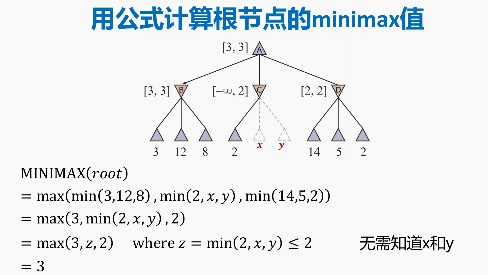
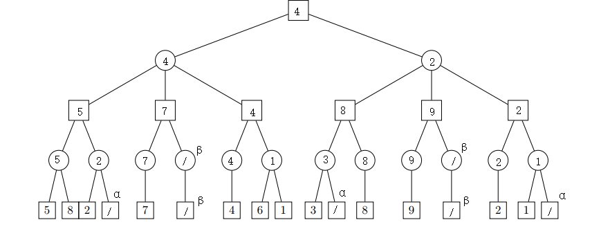
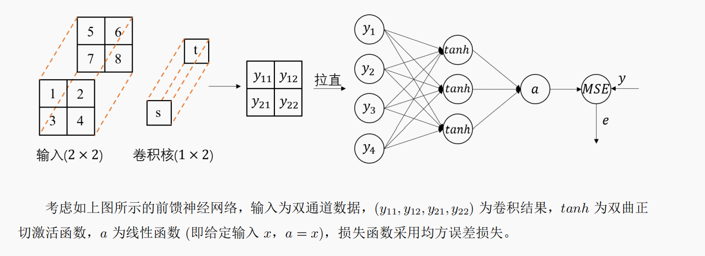

# ==人工智能原理 Cheatsheet · 搜索 / 神经网络 / 强化学习==

## ==一、搜索 Search==

### ==1.1 参数==

**参数定义**：

- $b$ = 分支因子（每个结点平均子结点数）

- $d$ = 最浅解深度（最优解的深度）

- $m$ = 树的最大深度（可能无穷）

- $\varepsilon$ = 最小单步代价（UCS 完备性要求每步代价 $>0$）

- 转移状态图：画邻接表

### ==1.2 无信息搜索（盲目搜索，无启发信息）==

| 准则 | **BFS** | **UCS** | **DFS** |

| --- | --- | --- | --- |

| 完备性 | 是\* | 是\* | 有限且防环时是 |

| 最优性 | 是† | 是 | 否 |

| 时间复杂度 | $b^d$ | 指数级，按路径代价层扩展 | $b^m$ |

| 空间复杂度 | $b^d$ | 指数级，通常很大 | $bm$ |

\*前提：分支因子有限且有解；†BFS 在各步代价相同时最优，UCS 总是最优（若各步代价>0）。特别地，如果是自己设计代价，那么由于UCS的最优性即可获得答案。

**目标测试何时停止（很重要）**：

- **画搜索树**：扩展某个结点时，把它生成的后继结点作为孩子加入搜索树；该结点本身通常在之前被生成时已经在树里。

- **BFS（单位代价/按层扩展）**：生成到目标时即可停止；

- **UCS / A\***：目标**入队时不能停**；必须等目标成为 OPEN 中 $g$ 或 $f$ 最小的结点并被取出/扩展时，才能保证最优

- **DFS / 贪心搜索**：若只要求任意解，遇到目标即可停；但不保证最优

### ==1.3 最佳优先搜索与启发式==

**最佳优先搜索**：OPEN 按评估函数 $f(n)$ 排序，每次扩展 $f$ 最小结点。

| 方法 | $f(n)$ | 特点 |

| --- | --- | --- |

| 贪心最佳优先 | $h(n)$ | 快，但不保证最优 |

| A* | $g(n)+h(n)$ | 同时看已走代价和剩余估计；在条件满足时最优 |

- $g(n)$ = 从初始到 $n$ 的实际代价（已走的）
- $h(n)$ = $n$ 到目标的估计代价（启发值，未来的）
- $f(n)$ = 经过 $n$ 到目标的预测总代价

**目标位置未知时：先探索再规划**：

- 用 BFS/DFS 或在线图搜索探索未知地图，记录可通行格、毒气格、墙/塌方边等已知信息。
- 每发现新区域，就在当前已知地图上用 A* 规划到最近的未探索边界。
- 一旦发现目标位置，就以该位置为目标重新运行 A*。
- 本质：未知环境中的在线搜索 / 实时重规划。

**启发函数的性质**（决定A*的优劣）：

- **可采纳（Admissible）** $h(n)\le h^*(n)$ 对所有 $n$（不高估）

- **一致（Consistent）** $h(n)\le c(n,a,n')+h(n')$ 对所有边（三角不等式）一致性更强

**启发函数设计**：

- **支配关系**：若 $\forall n,h_2(n)\ge h_1(n)$ 且两者都可采纳，则 $h_2$ 更好（扩展更少结点，更有信息）

- **构造方法**：曼哈顿距离 $h(n)=|x_n-x_g|+|y_n-y_g|$。

  - **一致性证明**：相邻移动一步代价 $c=1$，曼哈顿距离最多减少 $1$，所以 $h(n)-h(n')\le1$，即 $h(n)\le c(n,n')+h(n')$。

### ==1.4 复杂环境中的搜索==

**按“可观测性 × 确定性”选方法**：

| 情况 | 方法 |

| --- | --- |

| 完全可观测 + 确定动作 | 普通搜索（BFS/DFS/UCS/A*） |

| 完全可观测 + 不确定动作 | AND-OR 搜索，生成条件计划 |

| 部分/无观测 + 确定动作 | 信念状态搜索 |

| 部分/无观测 + 不确定动作 | 信念状态 + AND-OR 搜索 |

### ==1.5 对抗搜索（博弈树）==

**Minimax 算法**（二人零和博弈）：

$$V(s)=\begin{cases}Utility(s)&\text{terminal}\\\max_a V(Result(s,a))&\text{MAX}\\\min_a V(Result(s,a))&\text{MIN}\end{cases}$$

终局用真实效用；MAX 结点取最大值，MIN 结点取最小值。

- **MAX 结点**：我方，选让价值最大的动作

- **MIN 结点**：对手，选让我方损失最大的动作（对手最优应对）

- **结果**：根结点 $V$ 就是双方都最优下的价值

- 复杂度与评估：原始 $O(b^m)$ 通常太大

**α-β 剪枝**（关键优化，不改最终值）：

- $\alpha$ = MAX 已知的下界（至少能拿到）

- $\beta$ = MIN 已知的上界（对手至多丢掉）

- **剪枝条件**：

  - **α剪**：在 MIN 结点，若当前值 $\le\alpha$，剪掉剩余子树（MAX 已有更好选择，不会选这里）。

  - **β剪**：在 MAX 结点，若当前值 $\ge\beta$，剪掉剩余子树（MIN 已有更好选择，不会让你走这里）。

- **为什么不改结果**：被剪子树已经不可能影响祖先结点的选择。MIN 结点只会越取越小，若已 $\le\alpha$，MAX 不会选它；MAX 结点只会越取越大，若已 $\ge\beta$，MIN 不会选它。因此剪掉的只是“不可能被采用”的分支，根结点 minimax 值不变。

  

注：上图中 ▲、下图中⬛️ 为 MAX 结点。

**例题**：

### ==1.6 蒙特卡洛树搜索 MCTS（AlphaGo 的核心）==

**四步**：选择 $\to$ 扩展 $\to$ 模拟 $\to$ 回传。

**UCB1 公式**（选择阶段）：

$$UCB1(n)=\frac{w_n}{N_n}+C\sqrt{\frac{\ln N_{parent}}{N_n}}$$

**回传**：路径上每个结点 $N\leftarrow N+1$，胜则 $w\leftarrow w+1$。最终落子常选访问次数最多：

$$a^*=\arg\max_a N(s,a)$$

### ==1.7 约束满足问题 CSP==

**CSP 三要素**：变量 $\mathcal X$、定义域 $\mathcal D$、约束 $\mathcal C$。解 = 一致且完整的赋值。

**约束表示**：$\langle scope,rel\rangle$，如 $X_1>X_2$ 或允许元组集合 $\{(3,2),(3,1),(2,1)\}$。典型建模：地图着色、调度、数独。

**弧相容**：弧 $(X_i,X_j)$ 检查 $D_i$ 中每个值是否能在 $D_j$ 找到兼容值；注意方向。

**AC-3 算法**：

1. 所有二元约束弧入队。

2. 出队 $(X_i,X_j)$，执行 `REVISE(X_i,X_j)`，删掉 $D_i$ 中无支持的值。

3. 若 $D_i$ 变小，则把邻接弧 $(X_k,X_i)$ 入队。

4. 某域为空 $\to$ 无解；队列空 $\to$ 达到弧相容。复杂度常记 $O(cd^3)$。

**回溯搜索要点**：

- 变量：可选值最少、约束最多变量。

- 值：最宽松

- 赋值后继续删不可能的值：只检查直接邻居更快但较浅；每步都维护弧相容更慢但剪枝更强。

- 对大规模问题可用“最小冲突”局部搜索：从一个完整赋值开始，每次改冲突最多/最明显的变量，使冲突数下降。

## ==二、神经网络==

**过拟合 vs 欠拟合**：

| 问题 | 特征 | 解决 |

| --- | --- | --- |

| **过拟合** | 低训练误差，高验证/测试误差（高方差） | 加数据、加正则、早停、Dropout、减模型容量 |

| **欠拟合** | 高训练误差，高验证/测试误差（高偏差） | 增加模型容量、加特征、降低正则强度、训练更长 |

### ==2.2 线性回归（基础）==

**模型**：$h_w(x)=w^\top x+w_0 = \sum_i w_i x_i + w_0$（线性预测）

**损失函数（MSE，均方误差）**：

$$L(w)=\sum_{j=1}^n\bigl(y_j-h_w(x_j)\bigr)^2 = \lVert Xw-y\rVert^2$$

**求解方法**：

- **正规方程（闭式解）** $w^*=(X^\top X)^{-1}X^\top y$

- **梯度下降**：迭代求解

  - 梯度 $\nabla_w L=2X^\top(Xw-y)$（或 $2\sum(h_w(x_j)-y_j)x_j$）

  - 更新 $w \leftarrow w - \alpha\nabla_w L$（$\alpha$ 学习率）

- **随机梯度下降（SGD）**：每次只用一个样本或小批量样本估计梯度并更新参数，速度快但更新有噪声。

- **单样本 SGD**：$w \leftarrow w + \alpha(y-h_w(x))x$（平方损失下沿负梯度更新）

**评估指标**：

- $\text{MSE}=\frac1n\sum(\hat{y}_j-y_j)^2$（对异常值敏感）

- $\text{MAE}=\frac1n\sum|\hat{y}_j-y_j|$（鲁棒性好）

- $R^2=1-\frac{\sum(y_j-\hat{y}_j)^2}{\sum(y_j-\bar{y})^2}$（解释方差比例）

### ==2.3 分类：Logistic 线性分类==

**二分类：Logistic 回归**

- **Sigmoid 函数** $\sigma(z)=\dfrac{1}{1+e^{-z}}$（压缩到 $(0,1)$）

  - 模型：$h_w(x)=\sigma(w^\top x+b)$（输出概率）

  - 导数：$\sigma'(z)=\sigma(z)(1-\sigma(z))$

- **分类输出层**：二分类最后常接 **Sigmoid**，输出正类概率 $p$，负类概率为 $1-p$；多分类最后常接 **Softmax**：

  $$p_i=\dfrac{e^{z_i}}{\sum_j e^{z_j}}$$

  输出每一类的概率，概率和为 $1$。

- **二分类交叉熵**：若 $y\in\{0,1\}$，Sigmoid 输出正类概率 $p$，单样本损失

  $$\ell=-\bigl[y\log p+(1-y)\log(1-p)\bigr]$$

  批量时 $L=\frac1n\sum_i \ell_i$。$y=1$ 时只惩罚 $p$ 小；$y=0$ 时只惩罚 $1-p$ 小。

- **分类 vs 回归损失**：

  - 分类常用 **交叉熵**：二分类用上式，多分类用 $L=-\sum_i y_i\log p_i$；交叉熵来自伯努利极大似然，和 Sigmoid 输出概率匹配；

  - **MSE 不适合分类**：MSE 更像高斯误差假设，只看数值距离；但分类标签服从伯努利/类别分布，概率解释弱，配合 Sigmoid/Softmax 饱和时还容易梯度小、学习慢。

  - 回归常用 **线性输出层 + MSE**：$L=\frac1n\sum_i(\hat y_i-y_i)^2$。原因：回归预测连续值，MSE 直接惩罚预测值和真实值的距离，也对应高斯噪声下的最大似然；异常值多可用 MAE。

  - **交叉熵不适合普通回归**：交叉熵要求输出和标签都是概率/类别分布；普通回归标签是连续实数，不表示概率。若把回归输出接 Sigmoid/tanh，还会限制值域，通常应改成线性层。

### ==2.4 多层感知机 MLP（深度学习基础）==

**前向传播**：

$$z^{(l)} = W^{(l)}a^{(l-1)} + b^{(l)}, \quad a^{(l)} = g(z^{(l)})$$

- **tanh 导数**：若 $a=\tanh z$，则 $\dfrac{da}{dz}=1-\tanh^2 z=1-a^2$。

- **求和求导**：若式子里有 $\sum$，求导时保留求和符号，对每一项分别求导。

**例题：卷积参数 $s$ 的反向传播**

答案：

$$\frac{\partial e}{\partial s}=2(\hat y-y)\sum_j u_j(1-h_j^2)(w_{1j}+2w_{2j}+3w_{3j}+4w_{4j}).$$

若输出层换为 **Sigmoid**，损失函数换为二分类交叉熵，则输出层误差项变为 $p-y$，答案为

$$\frac{\partial e}{\partial s}=(p-y)\sum_j u_j(1-h_j^2)(w_{1j}+2w_{2j}+3w_{3j}+4w_{4j}).$$

### ==2.5 卷积神经网络 CNN==

**输出尺寸公式（记得乘起来）**：

$$H_{\text{out}} = \left\lfloor\frac{H_{\text{in}} - K + 2P}{S}\right\rfloor + 1$$

**参数量计算**：

$$N_{\text{param}} = C_{\text{out}}\bigl(C_{\text{in}}\cdot K\cdot K + 1\bigr)$$

- $C_{\text{in}}$ = 输入通道数，$C_{\text{out}}$ = 输出通道数 = 卷积核个数

  

**感受野**

- 考试常用递推：设第 $l$ 层感受野 $r_l$、相邻输出点在原图上的间隔 $j_l$

  - 初始：$r_0=1,\ j_0=1$

  - 卷积/池化层：$r_l=r_{l-1}+(K_l-1)j_{l-1}$，$j_l=j_{l-1}S_l$

**考试答法：如何确定最佳卷积核数量？**

- 可用 **网格搜索/逐步搜索**。把卷积核数量看作超参数，先试 $K=1,2,4,8,\dots,2^n$，在验证集上比较准确率或交叉熵损失。

- 若从 $2^m$ 到 $2^{m+1}$ 性能开始下降，就在这一区间附近细化搜索，选验证集表现最好的 $K$。

- 原因：卷积核太少易欠拟合，太多易过拟合且计算量大；测试集只用于最后评估。

## ==三、强化学习 RL==

### ==3.1 探索与多臂老虎机==

**UCB（上界置信度）**：

$$A_t=\arg\max_a\left[\underbrace{Q_t(a)}_{\text{return}}+\underbrace{c\sqrt{\frac{\ln t}{N_t(a)}}}_{\text{bonus}}\right]$$

### ==3.3 贝尔曼方程（重点）==

贝尔曼期望方程（$v$–$q$ 互推，展开即双重求和）：

$$v_\pi(s)=\sum_a\pi(a\mid s)\,q_\pi(s,a)$$

$$q_\pi(s,a)=\sum_{s',r}p(s',r\mid s,a)\bigl[r+\gamma\,v_\pi(s')\bigr]$$

**直观含义**：当前价值 = **立即回报** + **折扣未来价值**。

贝尔曼最优方程（用 $\max$ 替代期望求和）：

$$v_*(s)=\max_a\sum_{s',r}p(s',r\mid s,a)\bigl[r+\gamma\,v_*(s')\bigr]$$

$$q_*(s,a)=\sum_{s',r}p(s',r\mid s,a)\bigl[r+\gamma\max_{a'}q_*(s',a')\bigr]$$

最优策略 $\pi_*(s)=\operatorname*{argmax}_a q_*(s,a)$（贪心选最大 $q$ 值的动作）。

### ==3.4 动态规划（需知道模型 $p(s',r|s,a)$）==

**考试答法：状态转移概率已知时，怎么求最优策略？**

- 用 **动态规划 DP**，因为已知模型 $p(s',r\mid s,a)$，可以直接遍历状态、动作和后继状态。

- **策略迭代**：先做策略评估，求当前策略 $\pi$ 的 $v_\pi$ 或 $q_\pi$；再做策略改进，取

  $$\pi'(s)=\arg\max_a\sum_{s',r}p(s',r\mid s,a)[r+\gamma v_\pi(s')]$$

  反复迭代直到策略不变，得到 $\pi_*$。

- **价值迭代**：不完整评估某个固定策略，直接用贝尔曼最优方程更新

  $$v_{k+1}(s)=\max_a\sum_{s',r}p(s',r\mid s,a)[r+\gamma v_k(s')]$$

  收敛后对 $v_*$ 贪心得到 $\pi_*$。

- **异同**：二者都属于动态规划，都需要已知模型，并通过贝尔曼方程求最优策略。策略迭代分“评估 + 改进”，单轮较贵但轮数少；价值迭代每步直接取 $\max$，单轮便宜但可能轮数多。

### ==3.5 无模型方法：蒙特卡洛 MC（不需要模型）==

**蒙特卡洛**（需完整轨迹）：

- 轨迹：$s_0\xrightarrow{a_0,r_1}s_1\xrightarrow{a_1,r_2}\cdots\xrightarrow{a_{T-1},r_T}s_T$

- 从步 $t$ 计回报：$G_t=r_{t+1}+\gamma r_{t+2}+\gamma^2 r_{t+3}+\cdots+\gamma^{T-t-1}r_T$

- **首次访问**：每轨迹中 $s$ 首次出现的 $G$ 才用；**每次访问**：每次都用

**动作价值的 MC 估计**：

- 估计 $q_\pi(s,a)$ 时，对每次访问状态-动作对 $(s,a)$ 后的回报取平均

- 若要让每个状态-动作对都有机会被估计，需要持续探索；课件中讲到**试探性出发（Exploring Starts）**

**考试答法：状态转移概率未知时，怎么求最优策略？**

- 用 **无模型强化学习**，不需要知道 $p(s',r\mid s,a)$，而是通过和环境交互采样轨迹来估计动作价值 $q(s,a)$，再按 $q$ 贪心或 $\epsilon$-贪心改进策略。

- **MC 控制**：用完整回合的实际回报 $G_t$ 估计 $q(s,a)$，再做策略改进；不自举，但必须等一幕结束。

- **SARSA**（同策略 TD 控制）：

  $$Q(s,a)\leftarrow Q(s,a)+\alpha[r+\gamma Q(s',a')-Q(s,a)]$$

  用实际执行策略选出的下一个动作 $a'$ 更新，学到的是当前探索策略的价值。

- **Q-learning**（离策略 TD 控制）：

  $$Q(s,a)\leftarrow Q(s,a)+\alpha[r+\gamma\max_{a'}Q(s',a')-Q(s,a)]$$

  更新时直接假设下一步选最优动作，学到的是贪心最优策略的价值。

- **异同**：三者都不需要已知转移概率，靠采样学习价值。MC 用完整回报更新，通常要等一幕结束；SARSA 和 Q-learning 用一步 TD，可在线更新。SARSA 按实际执行动作学，较保守；Q-learning 按最优动作学，更直接逼近最优策略。

**考试答法：如果节点/状态数很多，怎么办？**

- 用 **函数逼近**，典型方法是 **DQN**：用神经网络近似 $Q_\theta(s,a)$，输入状态，输出各动作价值，再按 $\arg\max_a Q_\theta(s,a)$ 选动作。

- 训练时用 Q-learning 目标 $r+\gamma\max_{a'}Q(s',a')$；用**经验回放**打乱样本、提高利用率；用**目标网络**提供较稳定的目标值，避免训练震荡。
