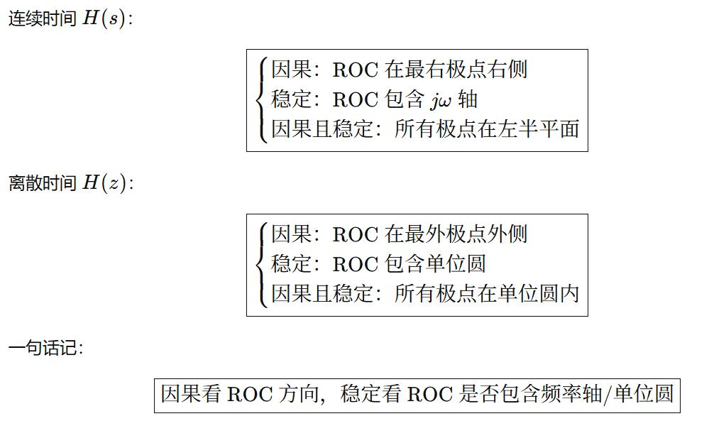
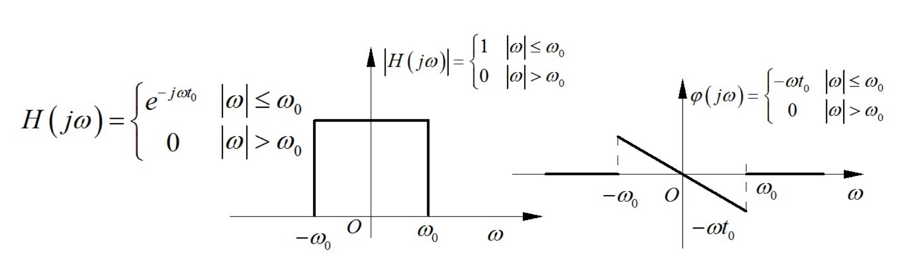
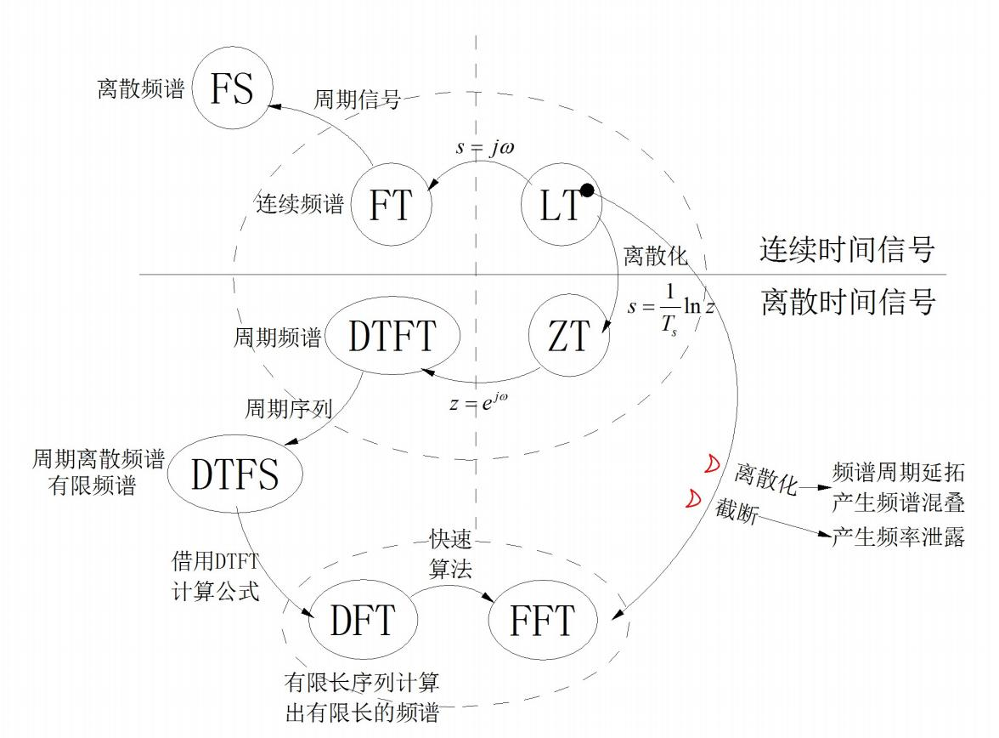

## <mark>1.1 连续时间信号</mark>

刘江宇 student

##### 奇异信号

不连续函数 / 其导数不连续

1. $\delta(at) = \frac{1}{|a|}\delta(t)$

2.  $\int ^{\infty} _{-\infty} \delta' (t-t_0)f(t)dt = -f'(t_0)$ 抽样特性

3.  $\delta '(t)f(t) = \delta'(t)f(0) - f'(0)\delta(t)$ 抽样特性

4.  抽样周期序列

      

      1. $\delta_T(t) = \Sigma ^{\infty} _ {-\infty} \delta(t - nT)$

      

      2. $\delta_T(t) \xrightarrow{FT} \omega_1\Sigma ^{\infty} _ {-\infty} \delta(\omega - n\omega _1)$

      

      3. $f_s(t) = f(t) \cdot \delta_T(t)$

   

## <mark>1.2 离散时间信号</mark>

##### 基本信号

1. 单位阶跃序列 $u[n]$ ($u[0] = 1 \ne 0.5$)

2. 单位斜变序列 $x[n]=nu[n]$

3. 单位脉冲序列 (单位样值序列)  $\delta[n]$

   

   1. $\delta[n] = u[n] - u[n-1]$

   

   2. $\delta[0]=1 \ne \infty$

4. 指数序列 $x[n] = \alpha^n u[n]$

##### LTI系统性质

线性、时不变、微分/积分特性、子系统交换律、子系统结合律、子系统分配律

## <mark>2.1 傅里叶级数FT</mark>

**三角函数形式**：

$f(t)=a_0+\sum\limits_{n=1}^{\infty}[a_ncos(n\omega_1t)+b_nsin(n\omega_1t)]$

$a_0=\frac{1}{T_1}\int_{-\frac{T_1}{2}}^{\frac{T_1}{2}}f(t)dt$

$a_n=\frac{2}{T_1}\int_{-\frac{T_1}{2}}^{\frac{T_1}{2}}f(t)cos(n\omega_1t)dt,\ b_n=\frac{2}{T_1}\int_{-\frac{T_1}{2}}^{\frac{T_1}{2}}f(t)sin(n\omega_1t)dt$

**指数形式**：

$f(t)=\sum\limits_{n=-\infty}^{+\infty}F(n\omega_1)e^{jn\omega_1t}$

$F_n=F(n\omega_1)=\frac{1}{T_1}\int_{-\frac{T_1}{2}}^{\frac{T_1}{2}}f(t)e^{-jn\omega_1t}dt=\frac{1}{2}(a_n-jb_n)$

$F_n = |F_n|e^{j\varphi_n} ; F(-n\omega_1) =\frac{1}{2}(a_n+jb_n); c_n = |F_n| + |F_{-n}|$

收敛条件：

1. 能量有限，$\int^T_0|f(t)|^2dt<\infty$;

2. 一个周期内信号绝对可积，$\int_{T_1}|x(t)|dt<\infty$；极大值、极小值、间断点有限且值有限

**Gibbs现象**：有限级数项合成波形，在间断点存在趋于跳跃值9%的峰起。例如傅里叶光学里光的衍射。

| 常见信号                                                                        | 傅里叶级数 |

| --------------------------------------------------------------------------- | ------------------------------------------------------------------------------------------------ |

| 周期方波（$-\dfrac{\tau}{2}\sim\dfrac{\tau}{2},0\sim E,T_1$） | $a_n=\dfrac{2E\tau}{T_1}Sa(\dfrac{n\omega_1\tau}{2}),b_n=0$ 频带宽度$B\approx \frac{2\pi}{\tau}$ |

| 周期锯齿（$-\dfrac{T_1}{2}\sim\dfrac{T_1}{2},-\dfrac{E}{2}\sim\dfrac{E}{2},T_1$） | $a_n=0,b_n=(-1)^{n+1}\dfrac{E}{n\pi}$                                                            |

| 周期三角（$-\dfrac{T_1}{2}\sim\dfrac{T_1}{2},0\sim\dfrac{E}{2},T_1$） | $a_n=\dfrac{4E}{(n\pi)^2}\sin^2(\dfrac{n\pi}{2}),b_n=0$                                          |

| 周期半波余弦                                                                      | $a_n=\dfrac{2E}{(1-n^2)\pi}\cos(\dfrac{n\pi}{2}),b_n=0$                                          |

| 周期全波余弦                                                                      | $a_n=(-1)^n\dfrac{4E}{(4n^2-1)\pi},b_n=0$                                                        |

| 周期脉冲                                                                        | $F_n=\dfrac{1}{T_1}=a_n,b_n=0$                                                                   |

**奇谐对称**：平移半个周期后与原函数上下对称，即$f(t)=-f(t+\frac{T}{2})$。

## <mark>2.2 傅里叶变换 FT</mark>

$F(\omega)=\int_{-\infty}^{\infty}f(t)e^{-j\omega t}dt$ && $f(t)=\frac{1}{2\pi}\int_{-\infty}^{\infty}F(\omega)e^{j\omega t}dt$

$F(\omega) = |F(\omega)|e^{j\varphi(\omega)}$ && $\varphi(\omega)=arctan[\frac{X(\omega)}{R(\omega)}]$

求f(t)面积 $S=\int_{-\infty}^\infty f(t)dt=F(0)$

**变换存在条件**：

1. 能量有限：$\int_{-\infty}^{\infty}|f(t)|^2 dt<+\infty$

2. **Dirichlet狄义赫利条件**：无限区间内信号绝对可积$\int|x(t)|dt<\infty$、极值点个数有限、间断点有限

广义傅里叶变换（绝对可积）如阶跃函数，符号函数：构造函数序列逼近  

$f(t)=\lim_{n\rightarrow\infty} f_n(t)$，$F(\omega)=\lim_{n\rightarrow\infty} F_n(\omega)$

**奇偶虚实特性**

实偶↔实奇  虚偶↔虚奇  实奇↔虚奇

**频谱衰减规律(越来越快)**

| $f(t)$ | 频谱衰减         |

| ------ | ------------ |

| 不连续 | $1/\omega$   |

| 一阶导不连续 | $1/\omega^2$ |

| 二阶导不连续 | $1/\omega^3$ |

| 常见信号                                                                          | $F(\omega)$                                                                                                                              |

|:-----------------------------------------------------------------------------:|:----------------------------------------------------------------------------------------------------------------------------------------:|

| $\delta(t)$                                                                   | $1$                                                                                                                                      |

| $u(t)$                                                                        | $\dfrac{1}{j\omega}+\pi\delta(\omega)$                                                                                                   |

| $sgn(t)$                                                                      | $\dfrac{2}{j\omega}$                                                                                                                     |

| $1$                                                                           | $2\pi\delta(\omega)$                                                                                                                     |

| $t\cdot u(t)$                                                                 | $j\pi\delta(\omega)-\dfrac{1}{\omega^2}$                                                                                                 |

| $e^{-at} u(t)$                                                                | $\dfrac{1}{a+j\omega}$                                                                                                                   |

| $e^{-a\|t\|}$                                                                 | $\dfrac{2a}{a^2 + \omega^2}$                                                                                                             |

| $e^{-at}u(t)-e^{-at}u(-t)$                                                    | $\|\dfrac{-2j\omega}{a^2 + \omega^2}\|$                                                                                                  |

| 矩形脉冲 $u(t+\frac{\tau}{2})-u(t-\frac{\tau}{2})$                                | $\tau Sa(\dfrac{\omega\tau}{2})$                                                                                                         |

| 抽样信号 $Sa(Wt)$                                                                 | $\dfrac{\pi}{W}[u(\omega+W)-u(\omega-W)]$                                                                                                |

| 三角脉冲 $1-\frac{2\|t\|}{\tau}$                                                  | $\dfrac{\tau}{2} Sa^2(\dfrac{\omega\tau}{4})$                                                                                            |

| 升余弦 $\frac{1}{2}(1+\cos\frac{\omega t}{2}), [-\frac{\tau}{2},\frac{\tau}{2}]$ | $\dfrac{E\tau}{2}\cdot\dfrac{Sa(\omega\tau/2)}{1-(\omega\tau/2\pi)^2}$                                                                   |

| 高斯信号 $E\cdot e^{-(t/\tau)^2}$                                                 | $\sqrt{\pi}E\tau\cdot e^{-(\omega\tau/2)^2}$                                                                                             |

| $e^{j\omega _1 t}$                                                            | $2\pi \delta(\omega-\omega_1)$                                                                                                           |

| $e^{-j\omega _1 t}$                                                           | $2\pi \delta(\omega+\omega_1)$                                                                                                           |

| $\sin(\omega_0 t)$                                                            | $j\pi[\delta(\omega+\omega_0)-\delta(\omega-\omega_0)]$                                                                                  |

| $\cos(\omega_0 t)$                                                            | $\pi[\delta(\omega+\omega_0)+\delta(\omega-\omega_0)]$                                                                                   |

| 周期信号$\sum_{n=-\infty}^{\infty} x_1\left(t-n T_0\right)$                       | $\omega_0 \sum_{n=-\infty}^{\infty} X_1\left(j n \omega_0\right) \delta\left(\omega-n \omega_0\right)$                                   |

| $\delta_T(t)=\sum_{n=-\infty}^{\infty} \delta\left(t-n T_0\right)$            | $\omega_0 \sum_{n=-\infty}^{\infty} \delta\left(\omega-n \omega_0\right)$                                                                |

| 抽样函数信号$\sum_{n=-\infty}^{\infty} x(t) \delta\left(t-n T_0\right)$             | $\frac{1}{T_s} \sum_{n=-\infty}^{\infty} X\left[j\left(\omega-n \omega_s\right)\right]$                                                  |

## <mark>2.3 傅里叶变换性质</mark>

| $f(t)$ | $F(\omega)$ |

|:---:|:---:|

| $\sum_{i=0}^na_if_i(t)$ | $\sum_{i=0}^na_iF_i(\omega)$ |

| $f^*(t)$ | $F^*(-\omega)$ |

| $f(at)$ | $\dfrac 1{\|a\|}F(\dfrac \omega a)$ |

| $f(t-t_0)$ | $F(\omega)e^{-j\omega t_0}$ |

| $f(at-t_0)$ | $\dfrac 1{\|a\|}F(\dfrac \omega a)e^{-j\frac {\omega t_0}a}$ |

| $f(t)e^{j\omega t_0}$ | $F(\omega-\omega_0)$ |

| $f(t)cos(\omega_0t)$ $f(t)sin(\omega_0t)$ | $\dfrac 12[F(\omega+\omega_0)+F(\omega-\omega_0)]$ $\dfrac j2[F(\omega+\omega_0)-F(\omega-\omega_0)]$ |

| $\dfrac {d^n}{dt^n}f(t)$ $(-jt)^nf(t)$ | $(j\omega)^nF(\omega)$ $\dfrac {d^n}{d\omega^n}F(\omega)$ |

| $\int_{-\infty}^tf(\tau)d\tau$ $-\dfrac {f(t)}{jt}+\pi f(0)\delta(t)$ （积分前$f(\tau)$面积为零则$F(0)=0$） | $\dfrac {F(\omega)}{j\omega}+\pi F(0)\delta(\omega)$ $\int_{-\infty}^{\omega}F(\Omega)d\Omega$ |

| $f_1(t)*f_2(t)$ $f_1(t)f_2(t)$ | $F_1(\omega)F_2(\omega)$ $\dfrac 1{2\pi}F_1(\omega)*F_2(\omega)$ |

| $F(t)$ | $2\pi f(-\omega)$ |

| $\int ^{\infty} _{-\infty} \|x(t)\|^2 dt$ | $\dfrac{1}{2\pi}\int ^{\infty} _{-\infty} \|X(\omega)\|^2 d\omega$ |

## <mark>2.4 周期信号傅里叶变换</mark>

时域周期延拓：$f_0(t) \leftrightarrow f_P(t)=\sum_{n=-\infty}^{\infty} f_0\left(t-n T_0\right)=f_0(t)*\sum_{n=-\infty}^{\infty} \delta\left(t-n T_0\right)$

频域离散化：

$F(\omega) \leftrightarrow F_P(\omega) = \omega_1\sum_{n=-\infty}^{\infty}F(n\omega_1)\delta(\omega-n\omega_1)$

## <mark>3 Laplace变换及其性质</mark>

**拉普拉斯正变换**：

- 双边LT: $F(s)=\int_{-\infty}^{\infty} e^{-st} f(t) dt$

- 单边LT:  $F(s)=\int_{0_{-}}^{\infty} e^{-st} f(t) dt$

**拉普拉斯反变换**：

1. 公式法；留数法：$f(t)=\frac{1}{2\pi j}\int_{\sigma -j\omega}^{\sigma +j\omega}F(s)e^{st}ds$

2. **因式分解法**：将$F(s)$化为有理真分式后，对原分式分母根的形式进行讨论：

   

   - **单实根** $F(s)=\sum_{i=1}^{m}\frac{k_i}{s-p_i}$

     

     则：$k_i=F(s)(s-p_i)|_{s=p_{i}}$；$f(t)=\sum_{i=1}^{n}k_{i}e^{+p_{i}t}$ 

   

   - **k重根** $F(s)=\frac{k_{11}}{(s-p_1)^k}+\frac{k_{12}}{(s-p_1)^{k-1}}+\cdot\cdot\cdot+\frac{k_{1k}}{s-p_1}+R(s)$

     

     则：$F_1(s)=(s-p_1)^kF(s);k_{im}=\frac{1}{(m-1)!}\frac{d^{m-1}}{dt^{m-1}}F_1(s)|_{s=p_1}$；$\frac{1}{(s-p_1)^k}\thicksim \frac{1}{(k-1)!}t^{k-1}e^{p_1t}u(t)$

   

   - **一对共轭复根**：

     

     - 直接配置成二阶因式：

       

       $e^{-at}sin(\omega t)\thicksim \frac{\omega}{(s+a)^2+\omega^2}$ ;$e^{-at}cos(\omega t)\thicksim \frac{s+a}{(s+a)^2+\omega^2}$

常见信号Laplace变换(单边)

| $f(t),(t>0)$           | $F(s)=\mathcal{L}[f(t)]$          | $f(t),(t>0)$                | $F(s)=\mathcal{L}[f(t)]$                |

| ---------------------- | --------------------------------- | --------------------------- | --------------------------------------- |

| $u(t)$                 | $\frac{1}{s}$                     | $te^{-at}$                  | $\frac{1}{(s+a)^2}$                     |

| $e^{-at}$              | $\frac{1}{s+a}$                   | $t^ne^{-at}$                | $\frac{n!}{(s+a)^{n+1}}$                |

| $t^{n}$                | $\frac{n!}{s^{n+1}}$              | $tsin(\omega t)$            | $\frac{2\omega s}{(s^2+\omega^2)^2}$    |

| $sin(\omega t)$        | $\frac{\omega}{s^2+\omega^2}$     | $tcos(\omega t)$            | $\frac{s^2-\omega^2}{(s^2+\omega^2)^2}$ |

| $cos(\omega t)$        | $\frac{s}{s^2+\omega^2}$          | $sinh(at)$                  | $\frac{a}{s^2-a^2}$                     |

| $e^{-at}sin(\omega t)$ | $\frac{\omega}{(s+a)^2+\omega^2}$ | $cosh(at)$                  | $\frac{s}{s^2-a^2}$                     |

| $e^{-at}cos(\omega t)$ | $\frac{s+a}{(s+a)^2+\omega^2}$    | $\frac{d^n\delta(t)}{dt^n}$ | $s^n$                                   |

Laplace变换性质：

| 性质       | 公式                                                                                                                                               |

|:--------:|:------------------------------------------------------------------------------------------------------------------------------------------------:|

| 线性（叠加） | $\mathcal{L}[k_1f_1(t)+k_2f_2(t)]=k_1F_1(s)+k_2F_2(s)$                                                                                           |

| 对$t$的微分 | $\mathcal{L}[\frac{df(t)}{dt}]=sF(s)-f(0^-)$ |

| 对$t$的积分 | $\mathcal{L}[\int_{-\infty}^tf(\tau)d\tau]=\frac{F(s)}{s}+\frac{\int_{-\infty}^0f(\tau)d\tau}{s}$                                                |

| 延时（时域平移） | $\mathcal{L}[f(t-t_0)u(t-t_0)]=e^{-st_0}F(s)$                                                                                                    |

| s域平移 | $\mathcal{L}[f(t)e^{-at}]=F(s+a)$                                                                                                                |

| 尺度变换     | $\mathcal{L}[f(at)]=\frac{1}{a}F(\frac{s}{a}), a>0$                                                                                              |

| 初值定理 | $\lim_{t \to 0_+}f(t)=\lim_{s \to \infty}sF(s)  $ |

| 终值定理 | $\lim_{t \to \infty}f(t)=\lim_{s \to 0}sF(s)  $ |

| 卷积       | $\mathcal{L}[f_1(t)*f_2(t)]=F_1(s)\cdot F_2(s)$                                                                                                  |

| 相乘（s域卷积） | $ \mathcal{L}[f_1(t)\cdot f_2(t)]=\frac{1}{2\pi j}[F_1(s)*F_2(s)] $ |

| 对s的微分 | $\mathcal{L}[-tf(t)]=\frac{dF(s)}{ds}$                                                                                                           |

| 对s的积分 | $\mathcal{L}[\frac{f(t)}{t}]=\int_s^{\infty}F(s)ds$                                                                                              |

初值定理条件：$F(s)$是真分式

终值定理条件：$f(\infty)$存在，即$F(s)$的极点都位于左半$s$平面，而在$s=0$处至多有一个单极点。

## <mark>4.1 Z变换及其性质</mark>

**Z变换与Z反变换**

$X(z)= \sum\limits_{n=-\infty}^{\infty}x[n]z^{-n}$

$x[n]= \frac{1}{2\pi j}\oint X(z)z^{n-1}dz$

**常用Z变换对**

| x[n]                                       | X(z)                                                                                |

|:------------------------------------------:|:-----------------------------------------------------------------------------------:|

| $\delta\left[n-m\right]\ \left(m>0\right)$ | $z^{-m} $                                                                           |

| $ u[n]$                                    | $\frac{1}{1-z^{-1}}$                                                                |

| $ n $                                      | $\frac{z}{(z-1)^{2}}$                                                               |

| $ n^{2} $                                  | $\frac{z(z+1)}{(z-1)^{3}}$                                                          |

| $ a^{n}(n=0,1,2...) $                      | $\frac{1}{1-az^{-1}}$                                                               |

| $ na^{n} $                                 | $\frac{az}{(z-a)^{2}}$                                                              |

| $ n^{2}a^{n} $                             | $\frac{az(z+a)}{(z-a)^{3}}$                                                         |

| $(n+1)a^{n} $                              | $\frac{z^2}{(z-a)^{2}}$                                                             |

| $\frac{(n+1)...(n+m)}{m!}a^{n} $           | $\frac{z^{m+1}}{(z-a)^{m+1}}$                                                       |

| $e^{an} $                                  | $\frac{z}{z-e^{a}}$                                                                 |

| $\frac{a^n}{n!} $                          | $e^{\frac{a}{z}}$                                                                   |

| $\frac{1}{(2n)!} $                         | $\cosh(z^{-\frac{1}{2}})$                                                           |

| $\frac{(\ln a)^n}{n!} $                    | $a^{\frac{1}{z}}$                                                                   |

| $\frac{1}{n} (n=1,2...)$                   | $\ln(\frac{z}{z-1})$                                                                |

| $\frac{n(n-1)...(n-m)}{m!} $               | $\frac{z}{(z-1)^{m+1}}$                                                             |

## <mark>4.2 Z逆变换</mark>

**因式分解法**：使用待定系数法将分式裂项。高阶极点Z变换对：$\frac{z}{(z-a)^2}\Leftrightarrow na^{n-1}un（原资料链接，未收录）...$

$\frac{z}{(z-a)^{m}}\Leftrightarrow\frac{n(n-1)\cdot\cdot\cdot(n-m+2)}{(m-1)!}a^{n-m+1}u[n]$  or $\Leftrightarrow-\frac{n(n-1)\cdot\cdot\cdot(n-m+2)}{(m-1)!}a^{n-m+1}u[-n-1]$

高阶极点：$B_{s-n}=\dfrac{1}{n!}\dfrac{d^n}{dz^n}[(z-z_i)^s\dfrac{X(z)}{z}];\  \dfrac{X(z)}{z}=\sum\limits^{s}_{j=1}\dfrac{B_j}{(z-z_i)^j}$

**留数法：**

一阶极点：$ {\mathrm{Res}}[X(z)z^{n-1}]_{z=p_{m}}=[(z-p_{m})X(z)z^{n-1}]_{z=p_{m}} $

高阶极点：$ \mathrm{Res}[X(z)z^{n-1}]_{z=p_{m}}=\dfrac{1}{(s-1)!}\{\dfrac{d^{s-1}}{d t^{s-1}}[(z-p_{m})^{s}\,X(z)z^{n-1}]\}_{z=p_{m}} $

留数定理2：$ \sum\limits_{C_{b,i}}\mathrm{Res}[F(z)]_{z=z_{i}}=-\sum\limits_{C_{o u t},o}\mathrm{Res}[F(z)]_{z=z_{o}} $

（路径内极点留数和等于负的路径外极点留数，用于z=0处有无穷阶极点等情况）

**Z变换性质：**

| 名称      | $x[n]$、$y[n]$                    | $X(z)$、$Y(z)$                                         |

| ------- | -------------------------------- | ----------------------------------------------------- |

| 线性性质    | $a\cdot x[n]+b\cdot y[n]$        | $a\cdot X(z)+b\cdot Y(z)$                             |

| 位移性质    | $x[n+m]$                         | $z^mX(z)$                                             |

| 指数加权    | $a^nx[n]$                        | $X(z/a)$                                              |

| 反褶      | $x[-n]$                          | $X(1/z)$                                              |

| 线性加权 | $nx[n]$                          | $-z\frac{d}{dz}X(z)$                                  |

| 共轭对称    | $x^*[n]$                         | $X^*(z)$                                              |

| 初值定理 | $x[0]$                           | $\lim_{z\rightarrow \infty}X(z)$                      |

| 终值定理 | $\lim_{n\rightarrow \infty}x[n]$ | $\lim_{z\rightarrow 1}(z-1)X(z)$                      |

| 卷积定理    | $x[n]*y[n]$                      | $X(z)\cdot Y(z)$                                      |

| 变换域卷积定理 | $x[n]y[n]$                       | $\dfrac{1}{2\pi j}\oint_CX(v)Y(\dfrac{z}{v})v^{-1}dv$ |

| 差分特性 | $\nabla x[n]=x[n]-x[n-1]$        | $(1-z^{-1})X(z)$                                      |

| 累加特性 | $\sum_{m=-\infty}^nx[m]$         | $\frac{1}{1-z^{-1}}X(z)$                              |

**初值定理使用条件**：$x[n]$为因果序列；

**终值定理使用条件**：$x[n]$为因果序列且终值收敛，即$(z-1)X(z)$的极点全在单位圆内（$X(z)$在$z=1$处至多一阶极点）。

**尺度变换与等距抽取**

- **补零扩张（尺度）**：$x_{(k)}[n]=\begin{cases}x[n/k] & n=0,k,2k,\ldots \\ 0 & \text{其他}\end{cases}$ 即在原序列相邻元素间插入$(k-1)$个零。对应$\mathcal{Z}[x_{(k)}[n]]=X(z^k)$。

- **等距抽取**：从序列$x[n]$中每隔$k$个点取一个样本得到$x_1[n]=x[kn]$。若已知$\mathcal{Z}[x[n]]=X(z)$，则$\mathcal{Z}[x_1[n]]=\frac{1}{k}\sum_{j=0}^{k-1}X(e^{-j\frac{2\pi}{k}}\cdot z^{1/k})$。

帕斯瓦尔定理：$\sum_{n=-\infty}^{+\infty}x[n]y^*[n]=\frac{1}{2\pi j}\oint_CX(v)Y^*(1/v^*)v^{-1}dv$

## <mark>5 Laplace变换求解微分方程，Z变换求解差分方程</mark>

***微分方程***：由已知的$y^{(n)}(0)$值可以解出$Y(s)$。注：$f(t)\leftrightarrow F(s)，\\ \frac{df(t)}{dt}\leftrightarrow sF(s)-f(0^-)，\\ \frac{d^2f(t)}{dt^2} \leftrightarrow s^2F(s)-sf(0^-)-f'(0^-)$

***差分方程***：注：$y[n-1]\leftrightarrow z^{-1}(Y[z]+zy[-1])，\\ y[n-2]\leftrightarrow z^{-2}(Y[z]+zy[-1]+z^{2}y[-2])，\\ y[n+1]\leftrightarrow z(Y(z)-y[0])，\\ y[n+2]\leftrightarrow z^2(Y(z)-y[0]-z^{-1}y[1])$

## <mark>6.1 拉普拉斯变换、傅里叶变换和Z变换</mark>

### 6.1.1 $s$平面与$z$平面的映射关系

$z=e^{sT}$时，$\widehat{X}(s)=X(e^{sT})$

$s$平面采用直角坐标系，$z$平面采用极坐标系，则：$s=\frac{1}{T_s}\ln(z)$

$\begin{cases}s=\sigma+j\Omega\\z=re^{j\omega}\\\end{cases}$   $\Rightarrow $ $\begin{cases}r=e^{\sigma T}\\\omega=\Omega T\\\end{cases}$     $T$为采样周期，采样角频率$\Omega_s=\frac{2\pi}{T}$

$\omega$增加则震荡频率增加；$r>1$ 指数增加，反之衰减

**系统稳定性因果性和极点的关系**

- 临界稳定系统

当激励有界时，系统的响应可能有界也可能无界

连续时间系统：虚轴上存在一阶极点；离散时间系统：单位圆上存在一阶极点

## <mark>6.2 系统频域特性分析</mark>

**理想低通滤波器**

1. 单位冲激响应 $h(t)=\frac{\omega_0}{\pi}Sa[\omega_0(t-t_0)]$

2. 单位阶跃响应 $g(t)=\frac{1}{2}+\frac{1}{\pi}Si[\omega_0(t-t_0)]$

3. 矩形波响应 $y(t)=\frac{1}{\pi}Si[\omega_0(t-t_0)]-\frac{1}{\pi}Si[\omega_0(t-t_0-\tau)]$

**系统频率特性总结**

对于虚轴左侧的零极点（右侧有相反变化）：

非常靠近虚轴的极点，会在频率附近幅频特性出现峰点，相频响应迅速减小；

非常靠近虚轴的零点，会在频率附近幅频特性出现下陷，相频响应迅速增加；

远离虚轴的零极点对于幅频和相频响应曲线影响很小，只对总的振幅和相位的相对大小有所增减

## <mark>6.3 零点分布对系统相位特性的影响</mark>

**最小相位系统**

最小单位系统单位阶跃响应具有负调现象，朝着反方向运动

## <mark>7.1 离散傅里叶变换</mark>

**离散时间傅里叶分析**：离散化导致另一个域周期性。

| | **周期序列 (DTFS)** | **非周期序列 (DTFT)** |

|:---:|:---:|:---:|

| **时域** | $\widetilde{x}[n]$（周期 $N$）| $x[n]$ |

| **频域** | $\widetilde{X}[k]$（离散）| $X(e^{j\omega})$（连续，周期 $2\pi$）|

**DTFS**（正/逆变换）：$\widetilde{X}[k]=\sum^{N-1}_{n=0} \widetilde{x}[n] W^{nk}\\ \widetilde{x}[n]=\frac{1}{N}\sum\limits^{N-1}_{k=0}\widetilde{X}[k]W^{-nk}$

**DTFT**（正/逆变换）：$X(e^{j\omega})=\sum\limits^{\infty}_{n=-\infty}x[n]e^{-j\omega n}\\ x[n]=\frac{1}{2\pi}\int^{\pi}_{-\pi}X(e^{j\omega})e^{j\omega n}d\omega$

其中 $W=e^{-j\frac{2\pi}{N}}$。

## <mark>7.2 离散傅里叶变换性质</mark>

令 $X[k]=DFT[x[n]],\ Y[k]=DFT[y[n]],\ H[k]=DFT[h[n]]$

**DFT常用性质**

+ **线性**：$ax[n]+by[n] \Leftrightarrow aX[k]+bY[k]$

+ **时域圆卷积**：

  $$f[n]=x[n]\circledast y[n]=\sum\limits^{N-1}_{m=0}x[m]y((n-m))_NR_N[n] \Leftrightarrow F[k]=X[k]Y[k]$$

+ **频域圆卷积**：

  $$y[n]=x[n]h[n] \Leftrightarrow Y[k]=\frac{1}{N}X[k]\circledast H[k]=\frac{1}{N}\sum\limits^{N-1}_{l=0}X[l]H((k-l))_NR_N[k]$$

+ **共轭对称**：$x^*[n] \Leftrightarrow X^*[N-k]$

+ **帕斯瓦尔定理**：$\sum\limits^{N-1}_{n=0}\lvert x[n]\rvert^2 = \frac{1}{N}\sum\limits^{N-1}_{k=0}\lvert X[k]\rvert^2$

## <mark>7.3 频率采样理论</mark>

当 $z=W^{-k}=e^{-\frac{2k\pi j}{N}}$ 时，x[n]的Z变换就等于该序列的离散傅里叶变换，即$X[k]=X(z)|_{z=W^{-k}}$

**频域采样不失真条件**：对于长度为M的序列，频域采样不失真的条件是 $N\geq M$，其中N为频域采样的点数。

## <mark>7.4 快速傅里叶变换 FFT</mark>

DFT 所需复数加法次数 $N^2$, 复数乘法次数 $N(N-1)$；FFT 所需复数加法次数 $N\log_2 N$，复数乘法次数 $\frac{N}{2}\log_2 N$。1次复数乘法相当于4次实数乘法，2次实数加法；一次复数加法相当于2次实数加法。

**快速卷积方案**：要计算x[n]*h[n]，可先将x[n]和h[n]补零到2的整数次幂，分别作FFT得到X(k),H(k)，再序列相乘得到X(k)H(k)，再对结果进行反傅里叶变换。复数乘法次数:$\frac{3N}{2}\log_2N+N$，即两次FFT+1次IFFT+序列相乘；复数加法次数: $3N\log_2 N$

用离散傅里叶变换作频谱分析的参数选择：

1. 采样频率$f_s$ 应满足奈奎斯特频率要求 ($\geq 2f_m$ ，其中$f_m$为信号最高频率)；

2. 模拟信号持续时间为 $t_c=NT=N/f_s=1/\Delta f$，其中 $\Delta f$ 为频率分辨率，T为采样间隔；

3. 离散傅里叶变换点数 $N\geq 2f_m/f$

**三种角频率关系**：模拟角频率 $\omega$ (rad/s)、采样角频率 $\omega_s$ (rad/s)、数字角频率 $\Omega$ (rad/sample)。$T_s=\frac{2\pi}{\omega_s}$，$\Omega=\omega T_s=2\pi\frac{\omega}{\omega_s}$，反之 $\omega=\frac{\Omega}{T_s}=\frac{\Omega}{2\pi}\omega_s$。$\Omega$ 以 $2\pi$ 为周期，采样后折叠到主值区间 $-\pi\le\Omega\le\pi$（重构频率即由折叠后的 $\Omega$ 还原）。

## <mark>8.1 调制和解调</mark>

+ **抑制载波振幅调制（AM-SC）**

  

  调制：$f(t)=g(t)\cos(\omega_0 t)$，频谱搬移 $F(\omega)=\frac{1}{2}[G(\omega+\omega_0)+G(\omega-\omega_0)]$

  

  解调：**乘积解调/同步解调** — 与$\cos(\omega_0 t)$相乘→低通滤波，需要**本地载波**

+ **振幅调制（AM）**

  

  调制：$[A+g(t)]\cos(\omega_0 t)$（$A$足够大，保证包络为正）

  

  解调：**包络检波器**，无需本地载波

+ **单边带调制（SSB）**

  

  双边带：$S_{AM}=\frac{1}{2}A_m[\cos(\omega_m+\omega_c)t+\cos(\omega_m-\omega_c)t]$

  

  单边带：保留上边带或下边带，**节约能量和带宽**

+ **脉冲波形传输—4800比特机问题**

  

  解决方案：全占空脉冲传输 | 四电平传输 | 时域信号设计 | 单边带调制

## <mark>8.2 采样和采样恢复</mark>

**1.时域理想采样**

时域上：$f_s(t)=f(t)\times\delta_T(t)=f(t)\sum\limits^{\infty}_{-\infty}\delta(t-nT_s)$

频域上：$F[f_s(t)]=1/T_s\sum\limits^{\infty}_{-\infty}[F(\omega-n\omega_s)]$

**2.频域理想采样**

频域上：$F_1(\omega)=F(\omega)\times\delta_T(t)=F(\omega)\sum\limits^{\infty}_{-\infty}\delta(\omega-n\omega_1)$

时域上：$f_1(t)=\frac{1}{\omega_1}\sum\limits^{\infty}_{-\infty}f(t-nT_1)$

**3.使用其它周期信号进行采样**

时域上：$f_s(t)=f(t)\times p(t)$，定义$p(t)$的傅里叶级数系数$P_n$:

$P_n=1/T_s[\int p(t)e^{-jn\omega_st}dt]$(积分上下限为$-T_s/2$至$T_s/2$)

频域上： $F[f_s(t)]=\sum\limits_{n=-\infty}^{\infty}P_nF(\omega-n\omega_s)$

**4.采样定理**

$f_s\geq2f_m$，即$\omega_s\geq 2\omega_m$

**5.欠采样的应用**

- 欠采样示波器、频闪灯

**6.信号的重建**

1. 零阶保持：**采样序列**与$[u(t)-u(t-T_s)]$卷积；相位谱上会出现$-\omega T_s/2$的相移，对应着恢复信号相对于原信号$T_s/2$的时移。

2. 一阶保持：采样序列与宽度为$T_s$，高度为1的三角波信号卷积

3. 能够无损恢复出信号的滤波器的频率特性：$H(\omega)=T_s(|\omega|\leq\omega_s/2);0(else)$

4. 补偿滤波器：在零阶保持或一阶保持后串联的滤波器，使得系统能够无损恢复出信号。其频率特性为：$H_r(\omega)=H(\omega)/H_0(\omega)$。$H_0(\omega)$为与采样序列卷积的信号的频谱。注意理想低通滤波器和补偿滤波器在工程上无法完美实现。

## <mark>9 数字滤波器</mark>

1. **系统可实现性条件**

   

**佩利—维纳准则**：如果系统频率特性**平方可积**$\int_{-\infty}^{\infty}|H(j\omega)|^2d\omega<\infty$，则$H(j\omega)$物理可实现的必要条件为$\int_{-\infty}^{\infty}{{|ln|H(j\omega)||}\over{1+\omega^2}}d\omega<\infty$

- 一般有理多项式构成的幅频特性能满足必要条件，只需判断是否**平方可积**

因果系统的系统函数$H(j\omega)=R(\omega)+jX(\omega)$满足**希尔伯特变换**关系：$R(\omega)={1\over\pi}\int_{-\infty}^{\infty}{{X(\lambda)}\over{\omega-\lambda}}d\lambda$， $X(\omega)=-{1\over\pi}\int_{-\infty}^{\infty}{{R(\lambda)}\over{\omega-\lambda}}d\lambda$

2. **无失真传输**

   

定义：系统响应波形与激励波形相同（幅度可以改变），出现时间不同

系统函数：$H(j\omega)=Ke^{-j{\omega}t_0}$

不产生相位失真的条件为：**群延时**为常数，即$-{{d\phi(\omega)}\over{d\omega}}=const$，相频函数不必是通过原点的直线，只要是直线就满足不失真。

失真传输的应用：产生特定波形、产生升余弦信号、声音合成

3. **匹配滤波器**

   后面有

4. **模拟滤波器**

   

高频滤波需要模拟滤波器；对于频率重叠的信号滤波可以使用非理想滤波器

5. **数字滤波器**

   

   + $H(e^{j\omega})={\sum_{n=0}^\infty}x[n]e^{-jn\omega}$，模为偶函数，相位是奇函数

   + **递归式**与**非递归式**：递归式$y[n]$表达式中包含$y[n-k]$项（$k=1,2,\cdots,N$）；非递归式不包含$y[n-k]$

   + **数字滤波器分类**：

      - **无限冲激响应（IIR）**：递归式，非线性相位

      - **有限冲激响应（FIR）**：非递归式，线性相位

   + **系统函数**：$H(z)={{{\sum_{r=0}^M}b_rz^{-r}}\over{1+{\sum_{k=1}^N}a_kz^{-k}}}$；若存在$a_k≠0$构成**IIR**，$a_k$均为0对应**FIR**

   + **IIR结构实现**：

      - **直接型I、II**：II型（典范结构）延时单元最少，但精度要求高，调整不方便

      - **级催实现**：因式分解为一阶/二阶级联，便于调整，乘法次数较多

      - **并联实现**：部分分式展开，运行速度快，可单独调整极点，但无法控制零点

   + **FIR滤波器特性**（稳定系统）：有限长实序列$h[n]$满足**偶对称**或**奇对称**，对应频率特性具有**线性相位**

## <mark>10 简答题汇总</mark>

1. **频率泄露是什么？如何减小影响？**

**原因**：DFT分析时对信号有限长截取，引起频谱失真；**表现**：幅值波动、突变处出现过渡带；**减小方法**：①增加截取长度，减小过渡带宽度；②采用光滑窗函数，减小波动幅度，但过渡带会变宽。

2. **匹配滤波器的特点、应用条件？如何提高延迟测量精度？**

**特点**：冲激响应为待测信号反褶并延迟，$h(t)=k\cdot s(t_m-t)$；本质是相关运算，用相关峰检测延迟和幅值。**条件**：已知信号波形；接收信号为无失真延迟信号加白噪声，$a\cdot s(t-t_m)+n_0(t)$。**提精度**：检测信号应有较宽频带，使相关峰更尖锐、更窄。

3. **什么是吉布斯现象？相关物理现象有哪些？**

**定义**：有限项傅里叶级数合成含间断点的周期信号时，间断点附近出现过冲和振荡；**特点**：过冲约为跳变幅值的9%，项数增加也不消失；**例子**：有限带宽系统的振铃现象、傅里叶光学中的衍射现象。

4. **DFT计算周期成分可能产生哪些误差？如何消除或减轻？**

**频率混叠**：采样频率不足，不同频率成分采样后重叠致频谱失真；减轻：提高采样频率、采样前加**抗混叠滤波器**。**频率泄漏**：有限时间截断信号使频谱能量扩散到邻近频率；减轻：延长采样时间或对数据**加窗**。**栅栏现象**：DFT只在离散频率点上取样，可能漏掉真实频率峰值；减轻：延长采样时间提高频率分辨率，或**补零**增加频谱显示点数。**幅度变化**：DFT计算常省略采样周期 $T_s$（相当于令 $T_s=1$），频谱幅值发生比例变化；修正：将结果乘以 $T_s$。

5. **如果数据采样数值对应信号实际电压幅值，如何使 FFT 计算出的频谱数值反映实际信号中频率幅值？**

**幅值换算**：FFT计算结果乘以采样时间间隔 $T_s=1/f_s$，即可使频谱数值反映实际信号的频率幅值。

6. **简要叙述序列的 ZT、DTFT、DFT、FFT 之间的关系。**

ZT 是离散序列最一般的变换形式，定义在整个 $z$ 平面上；DTFT 是在 ZT 的单位圆 $z=e^{j\omega}$ 上取值得到的频谱；DFT 是对有限长序列的 DTFT 在一个周期内进行 $N$ 点等间隔抽样；FFT 不是新的变换，而是快速计算 DFT 的算法。

7. **请简要说明使用加窗方法设计FIR低通滤波器的步骤。**

先根据理想低通滤波器的幅频特性确定理想频率响应 $H_d(e^{j\omega})$，再求其对应的理想单位冲激响应 $h_d(n)$；由于 $h_d(n)$ 通常无限长且非因果，需要选择合适的窗函数 $w(n)$ 和长度 $N$，对 $h_d(n)$ 截断并平移，得到有限长因果冲激响应 $h(n)=h_d(n)w(n)$；最后根据 $h(n)$ 写出 FIR 滤波器系统函数，并检验幅频特性是否满足指标要求。
